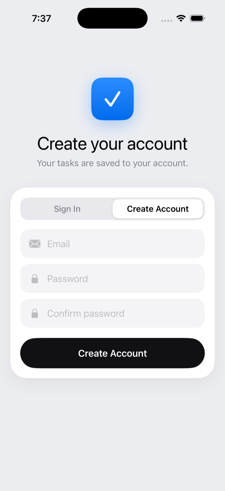
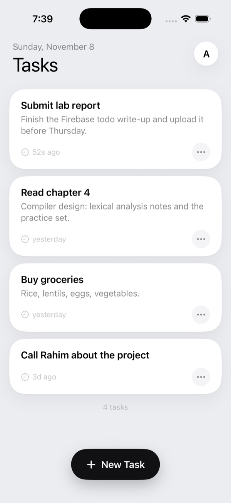
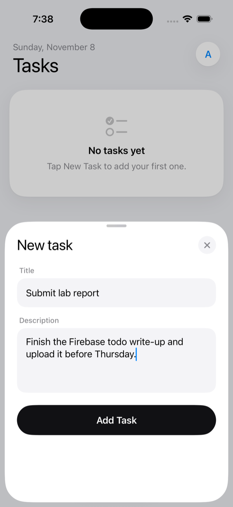
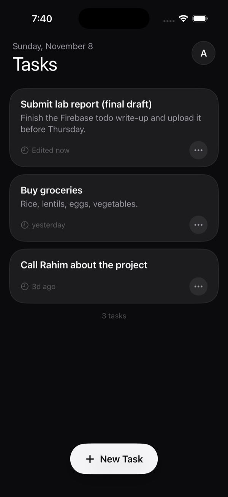

# Firebase Todo (iOS)

A SwiftUI todo list for iPhone, built for the Mobile Computing course. Each user signs in with email and password and keeps their own tasks in Cloud Firestore.

<p>
  
  
  
  
</p>

- Each task has a **title** and a **description**.
- Full CRUD: **New Task** button to add, a live list to read, tap a card to edit, and the ••• menu (or a long press) to edit or delete, with a confirmation before deleting.
- **Firebase Authentication** with email and password: create account, sign in, sign out (tap your initial at the top right).
- Tasks are stored in **Firestore** under the signed-in user, and security rules stop anyone else from reading or changing them.
- White cards on a pearl-grey page, a black main button, and a matching dark mode that follows the phone's setting.

SwiftUI, iOS 17+, Firebase iOS SDK 13 (Swift Package Manager). The Xcode project is generated from `project.yml` with [XcodeGen](https://github.com/yonaskolb/XcodeGen).

## Connect it to the Firebase project

Authentication (Email/Password), the Firestore database and the rules in `firestore.rules` are already set up in project `todo-f0aa6`. The iOS app only needs its own config file:

1. Firebase console → **Project settings** (gear icon) → **General** → **Your apps** → **Add app** → the **Apple (iOS)** icon.
2. **Apple bundle ID:** `com.ajoy.todo` (must match exactly). Nickname: `Todo iOS`. Leave App Store ID empty. Click **Register app**.
3. Click **Download GoogleService-Info.plist** and move the file into the `FirebaseTodo/` folder (next to `App`, `Auth` and `Tasks`).
4. Skip the console's "Add Firebase SDK" and "Add initialization code" steps. The project already does both.
5. Open the project:
   ```bash
   open FirebaseTodo.xcodeproj
   ```
6. Pick an iPhone simulator and press **Run** (⌘R).

`GoogleService-Info.plist` is listed in `.gitignore`, so it never goes to GitHub. A build step copies it into the app when the file is there; without it the app shows a "Connect Firebase" screen instead of crashing.

The Xcode project is generated from `project.yml`. After adding or removing Swift files, run `xcodegen generate` (install with `brew install xcodegen`).

To run on a real iPhone, choose your Apple ID team under the target's **Signing & Capabilities**.

## Run it against the local Firebase emulators

No real project needed. The emulators need Node.js and Java 21+.

```bash
npx firebase-tools emulators:start --only auth,firestore --project demo-todo
```

Then in Xcode: **Product → Scheme → Edit Scheme → Run → Arguments** and tick `-useEmulators`. Run the app in the simulator. Accounts and tasks live only until the emulators stop; the Emulator UI at http://127.0.0.1:4000 shows them.

## How the data is stored

```
users/{uid}/tasks/{taskId}
  title:       string    (1–100 characters, required)
  description: string    (up to 1000 characters, may be empty)
  createdAt:   timestamp (set by the server)
  updatedAt:   timestamp (set by the server on every edit)
```

The app only ever reads `users/{currentUser.uid}/tasks`, newest first, with a live listener.

## Security rules

`firestore.rules` (published in the Firebase console) allows a request only when the signed-in user's uid matches the `{uid}` in the path, and checks that a task has only the four fields above, a 1–100 character title, a description of at most 1000 characters, server timestamps, and an unchanged `createdAt` on edits. Everything else is closed.

## Project layout

```
FirebaseTodo/
  App/
    FirebaseTodoApp.swift   App entry point
    FirebaseSetup.swift     Starts Firebase (real project or local emulators)
    RootView.swift          Sign-in screen or task list, based on who is signed in
  Auth/
    AuthStore.swift         Signed-in user, sign in / create account / sign out, error messages
    AuthView.swift          Sign in and create account screen
  Tasks/
    TodoTask.swift          Task model and "2h ago" style times
    TaskStore.swift         Firestore CRUD: add, live read, update, delete
    TaskListView.swift      Task cards with a ••• menu, account menu, New Task button
    TaskEditorView.swift    Title + description sheet for adding and editing
  Design/
    Pearl.swift             Colours (light and dark), card style, black button, fields, segmented switch
  Assets.xcassets           App icon
Screenshots/                Screenshots used in this README
project.yml                 XcodeGen project definition
firestore.rules             Firestore security rules
firebase.json               Emulator ports for the Firebase CLI
```
